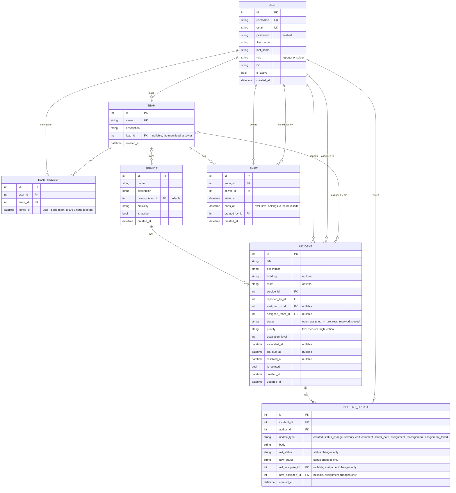

# ER Diagram

Seven tables. Every line is a foreign key. The same diagram in PlantUML is in [`er-diagram.puml`](er-diagram.puml).

## Relationships

| Relationship | Type | Via |
|---|---|---|
| User ↔ Team (membership) | many-to-many | `TEAM_MEMBER` |
| User → Team (lead) | one-to-many, optional | `TEAM.lead_id` |
| Team → Service | one-to-many, optional | `SERVICE.owning_team_id` |
| Service → Incident | one-to-many | `INCIDENT.service_id` |
| User → Incident (reporter) | one-to-many | `INCIDENT.reported_by_id` |
| User → Incident (assignee) | one-to-many, optional | `INCIDENT.assigned_to_id` |
| Team → Incident (assigned team) | one-to-many, optional | `INCIDENT.assigned_team_id` |
| Incident → Incident Update | one-to-many | `INCIDENT_UPDATE.incident_id` |
| User → Incident Update (author) | one-to-many | `INCIDENT_UPDATE.author_id` |
| User → Incident Update (old and new assignee) | one-to-many, optional | `INCIDENT_UPDATE.old_assignee_id`, `INCIDENT_UPDATE.new_assignee_id` |
| Team → Shift | one-to-many | `SHIFT.team_id` |
| User → Shift (solver) | one-to-many | `SHIFT.solver_id` |
| User → Shift (scheduled by) | one-to-many | `SHIFT.created_by_id` |

Incidents are never physically deleted: `is_deleted` hides a ticket and keeps its history. A shift covers `starts_at` up to, but not including, `ends_at`. The database refuses a shift whose end is not after its start.
